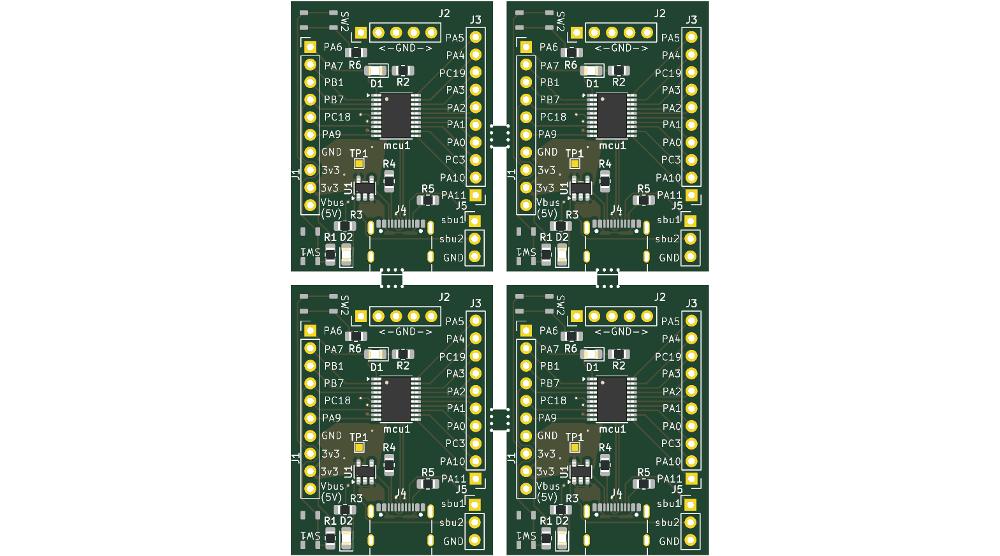
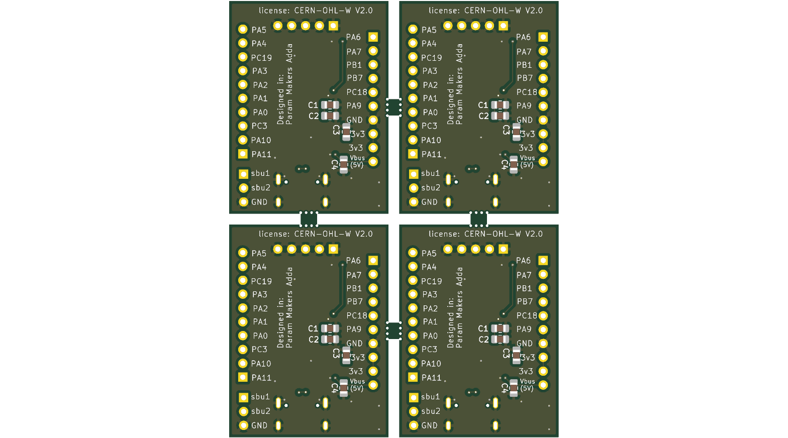
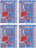

# PCB Panelization

This directory contains the panelized PCB design for the CH32 development board.

## Generating the Panel

Panelization is automated using **KiKit** through a **KiCad Jobset**.

1. Open the KiCad project.
2. Open the Jobset file (`.kicad_jobset`).
3. Click **Run** on the **Panelise** job.

The panelized PCB will be generated automatically.

## Example Panel Configuration

- **Layout:** 3 × 3 (9 PCBs)
- **Spacing:** 2 mm
- **Tabs:** 3 mm wide
- **Separation:** Mouse bites
- **Mouse-bite drill diameter:** 0.5 mm
- **Mouse-bite hole spacing:** 1 mm
- **Mouse-bite offset:** 0.2 mm

## Images Example

front

back

routing  

## Requirements

- KiCad
- KiKit (installed and accessible from the system PATH)

## Notes

- The panel is generated from the original PCB design.
- Rerun the **Panelise** job whenever the original PCB is modified.
- The generated panelized PCB is intended for manufacturing.
